# pocket-modeling

<p align="center">
  
</p>


EventStorming／DDD のドメインモデリングと、Kimball 流ディメンショナル・モデリングを **対話で進めるためのファシリテータースキル一式** を抱えるナレッジリポジトリ。アプリケーションコードは持たず、AI（Claude Code）と人間がモデルを育てるための仕組みと、その生成物だけを管理する。

| 軸 | スキル | 何のモデルか | ソース・オブ・トゥルース |
| --- | --- | --- | --- |
| DDD（EventStorming） | `eventstorming-facilitator` | 業務が正しく動くための **運用モデル** | `docs/eventstorming/*.dml.yaml` |
| ディメンショナル（Kimball） | `dimensional-modeling-facilitator` | 業務を測るための **分析モデル**（DWH／BI） | `docs/dimensional/*.dimml.yaml` |

2 つは独立した別成果物で、互いに干渉しない。

## 何ができるか

「このドメインを整理したい」と話しかけると、Claude Code が EventStorming の流儀でドメインイベント・コマンド・集約・ポリシー・リードモデル・境界づけられたコンテキストを会話から発見し、**DML（Domain Modeling Language、YAML）** に情報圧縮していく。DML から閲覧用の HTML が自動生成され、ストーリー・フロー図・意思決定ログなどが一望できる。

呼び出しの合図（例）:

- 「ドメインモデリングしたい」「イベントストーミングやろう」
- 「DDD で整理したい」「DML を育てたい」
- 既存 DML のリファイン、新機能のドメインモデル起こし
- 「ディメンショナル・モデリング」「スタースキーマ」「バスマトリクス」「ファクト表を設計したい」「グレインを決めたい」（DimML）

## 生成物

| 種類 | パス | 役割 |
| --- | --- | --- |
| DML（真実源） | `docs/eventstorming/<session>.dml.yaml` | AI が `dmlctl` 経由で育てる唯一のソース |
| HTML（派生物） | `dist/eventstorming/<session>.html` | DML から機械生成。`dist/` は gitignore 済み、**手編集しない** |
| DimML（真実源） | `docs/dimensional/<session>.dimml.yaml` | ディメンショナル・モデルのソース |
| HTML（派生物） | `dist/dimensional/<session>.html` | バスマトリクス＋スタースキーマ。手編集しない |

セッションは EventStorming が `eventstorming-YYYYMMDD-HHMM`、ディメンショナルが `dimensional-YYYYMMDD-HHMM` 形式で保存する。

## パイプライン

DML → HTML の **片方向** パイプライン。AI も人間も DML 側だけを触る。

```
docs/eventstorming/*.dml.yaml ──┬──→ eventstorming_build.py ──→ dist/eventstorming/*.html
                                ├──→ validate_dml.py   (JSON Schema 構文検証)
                                └──→ dmlctl.py         (views / checks / set / add / remove)
```

**DML への I/O は `dmlctl.py` 経由のみ。** `docs/eventstorming/*.dml.yaml` への `Read`/`Edit`/`Write` は PreToolUse フック（`.claude/settings.json` → `scripts/hooks/block_direct_dml.py`）がブロックする。`dmlctl` の書き込み系コマンド（`init`/`set`/`add`/`update`/`remove`）は build＋validate を自動実行する。PostToolUse hook は直接書き込みがすり抜けた場合の安全網。手動編集が必要なら Claude Code の外のエディタを使う。

DimML は別パイプライン（`validate_dimml.py` → `dimml_build.py`）で、専用 CLI もブロックフックも無い。AI が直接 `Read`/`Write`/`Edit` し、書き込み後に validate → build を手で回す。

## ディレクトリ構成

```
.
├── CLAUDE.md                     # Claude Code 向けの運用ガイド（開発者も必読）
├── docs/
│   ├── eventstorming/            # DML セッションファイル（真実源）
│   ├── dimensional/              # DimML セッションファイル（真実源）
│   └── skill-improvements/       # スキル改善メモ
├── dist/eventstorming/           # 生成 HTML（gitignore）
├── dist/dimensional/             # 生成 HTML（gitignore）
├── .claude/skills/dimensional-modeling-facilitator/
│   ├── SKILL.md                  # Kimball モデリングのワークフロー
│   ├── references/               # dimensional-playbook.md（正典）/ dimml.schema.yaml ほか
│   ├── scripts/                  # validate_dimml.py / dimml_build.py
│   ├── templates/ examples/
└── .claude/skills/eventstorming-facilitator/
    ├── SKILL.md                  # ファシリテーション ワークフロー（9 フェーズ）
    ├── references/
    │   ├── ddd-playbook.md       # DDD モデリングルールの正典（概念軸で横断集約）
    │   ├── dml.schema.yaml       # DML の JSON Schema（Draft 2020-12）
    │   ├── checks/*.md           # 意味チェック 6 観点（LLM ベース）
    │   └── ...                   # quality-check / causal-check / session-guide ほか
    ├── scripts/
    │   ├── eventstorming_build.py  # DML → HTML レンダラ（全 9 セクション）
    │   ├── validate_dml.py         # Schema 構文検証
    │   ├── dmlctl.py               # 観点別スライス I/O・構造チェック
    │   └── dml_filters/            # views（16）/ checks（18）の実装
    ├── templates/event-flow.html
    └── examples/sample.dml.yaml
```

## セットアップ

1. リポジトリを clone し、ルートで [Claude Code](https://claude.com/claude-code) を起動する（`.claude/settings.json` のフックとスキルが自動で有効になる。スクリプトはリポジトリルートからの相対パスで動く。フックは `$CLAUDE_PROJECT_DIR` 基準なので、作業フォルダがサブフォルダに移っても効く）。
2. Python 3 と依存ライブラリを入れる:

```sh
pip install -r .claude/skills/eventstorming-facilitator/requirements.txt
```

Claude Code のセッション開始時には SessionStart フック（`.claude/hooks/session-start.sh`）が同じものを入れる（入っていれば何もしない）。クラウドの新しいセッションでも、最初の `dmlctl init` が依存不足で落ちない。

- `pyyaml` / `jsonschema` — 検証・ビルド用
- `ruamel.yaml` — `dmlctl` の構造化編集（set/add/remove、コメント・引用形式を維持）用

3. （任意）集約をまたぐ不変条件のモデル検査（`dmlctl quint`）を使う場合のみ Node.js と Quint CLI:

```sh
npm i -g @informalsystems/quint
```

4. 動作確認:

```sh
python3 .claude/skills/eventstorming-facilitator/scripts/dmlctl.py build --all
python3 .claude/skills/dimensional-modeling-facilitator/scripts/dimml_build.py --all   # docs/dimensional/ が空なら対象なし
open dist/eventstorming/*.html   # または任意のブラウザで開く
```

### 使い始める

Claude Code に話しかけるだけ。「イベントストーミングやろう」「スタースキーマを設計したい」などでスキルが起動する。新規 DML は `dmlctl init`、新規 DimML は `references/template.dimml.yaml` をコピーして `session` を埋めて作る（完成例は `examples/retail-sales.dimml.yaml`）。Artifact ツールが使えるセッションでは、HTML を Artifact として公開し、質問パネルに 1 問ずつ出して回答を DML に反映するグリル運用ができる（`eventstorming_build.py <dml> --artifact`、詳細は SKILL.md「Artifact 上のグリル」。ディメンショナル側は未対応）。

## よく使うコマンド

```sh
SKILL=.claude/skills/eventstorming-facilitator/scripts

# 観点別スライス取得（コンテキスト節約。大きい DML は全文 Read しない）
python3 $SKILL/dmlctl.py views                                   # view 名一覧
python3 $SKILL/dmlctl.py view <file> --view=<name> [--ctx=... --name=...]

# 構造化編集
python3 $SKILL/dmlctl.py set    <file> --path=<a.b.c>   --value=<yaml-literal>
python3 $SKILL/dmlctl.py add    <file> --to=<list-path> --item=<yaml-literal>
python3 $SKILL/dmlctl.py remove <file> --path=<a.b.c>

# パスの期待型ヒント（書き込み前の型確認。ファイル引数不要）
python3 $SKILL/dmlctl.py hint --path=<a.b.c>          # 例: queries.users / scenarios[].brs[].pol

# セッション進行（phase 前進・action 完了トグル）
python3 $SKILL/dmlctl.py advance <file> [--phase=<v>] [--status=<text>]
python3 $SKILL/dmlctl.py action  <file> --id=<id> [--not-done]

# 識別子の横断検索 / 一括リネーム（用語統一・state 改名。--ctx で BC 内に限定可）
python3 $SKILL/dmlctl.py refs   <file> --name=<identifier>
python3 $SKILL/dmlctl.py rename <file> --from=<old> --to=<new> [--ctx=<bc>] [--dry-run]

# 構造チェック（LLM 不要）
python3 $SKILL/dmlctl.py checks                                  # check 名一覧
python3 $SKILL/dmlctl.py check <file> --all                      # 全観点を一括実行（clean/results サマリ）
python3 $SKILL/dmlctl.py check <file> --check=<name>             # 個別観点

# 新規 DML 作成（テンプレートから session 入りの空 DML を生成）
python3 $SKILL/dmlctl.py init <file> --session-id=<id> --domain=<name> [--goal=...]

# 集約またぎの不変条件検査（DML の invariants[] を Quint に変換。quint CLI 必須）
python3 $SKILL/dmlctl.py quint <file> --run

# 検証 / ビルド（dmlctl の書き込み系は自動実行。手動は補助用途）
python3 $SKILL/validate_dml.py <file>.dml.yaml
python3 $SKILL/eventstorming_build.py <file>.dml.yaml
python3 $SKILL/eventstorming_build.py --all                      # 全件
python3 $SKILL/eventstorming_build.py --watch                    # 監視モード
```

## ディメンショナル・モデリングのコマンド

```sh
DIM=.claude/skills/dimensional-modeling-facilitator/scripts

python3 $DIM/validate_dimml.py docs/dimensional/<session>.dimml.yaml   # 構文＋参照整合（違反で exit 1）
python3 $DIM/dimml_build.py docs/dimensional/<session>.dimml.yaml      # バスマトリクス＋スタースキーマ HTML
python3 $DIM/dimml_build.py --all
```

## 2 段の検証

- **構文 validity** — `validate_dml.py` が JSON Schema で機械検証。Schema 通過は必要条件であって十分条件ではない
- **意味 validity** — 参照の実在・因果整合・モデル品質は `references/checks/*.md` の 6 観点を LLM（Agent tool）で 1 つずつチェックする。詳細は `references/quality-check.md`

## もっと知る

- 運用原則・命名規約・アーキテクチャ詳細 → [CLAUDE.md](./CLAUDE.md)
- ファシリテーションの進め方 → `.claude/skills/eventstorming-facilitator/SKILL.md`
- ディメンショナル・モデリング → `.claude/skills/dimensional-modeling-facilitator/SKILL.md`、ルール正典 `references/dimensional-playbook.md`、構文 `references/dimml.schema.yaml`
- DDD モデリングルール（定義・命名・設計判断・検証観点）→ `references/ddd-playbook.md`
- DML の構文（型・enum・命名 pattern）→ `references/dml.schema.yaml`
